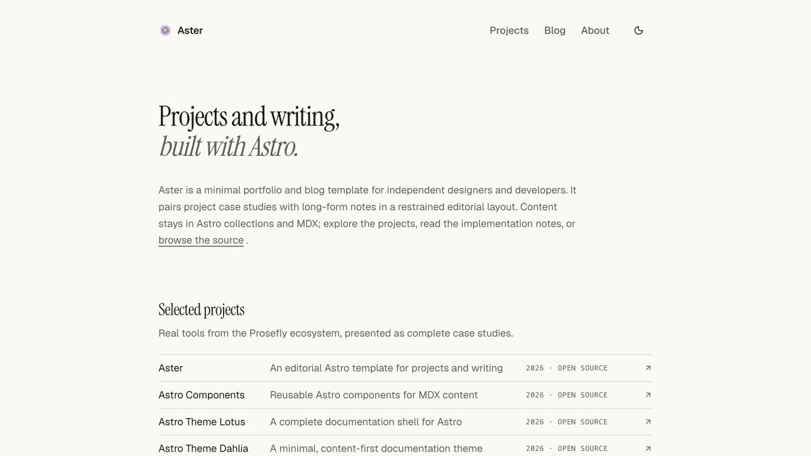

<p align="center">
  
</p>

<h1 align="center">Aster</h1>

<p align="center">
  <strong>An editorial Astro template for projects, case studies, and long-form writing.</strong><br />
  Built for independent designers and developers who want the work and the thinking behind it to
  live together.
</p>

<p align="center">
  <a href="https://astro-template-aster.prosefly.dev/">Live demo</a> ·
  <a href="https://astro-template-aster.prosefly.dev/projects/">Explore projects</a> ·
  <a href="https://astro-template-aster.prosefly.dev/blog/astro-components-tour/">Component showcase</a>
</p>

<a href="https://astro-template-aster.prosefly.dev/">
  
</a>

Aster gives your portfolio and your writing a shared narrative. Projects show the finished work;
posts preserve the decisions, experiments, and lessons behind it. Link a post to a project in one
frontmatter field and Aster brings that context back to the project page automatically.

The design stays deliberately quiet: expressive typography, generous space, thin rules, and lists
that reveal structure without turning every entry into a card.

## Why Aster

- **Projects and writing belong together.** Separate Astro collections keep each content type
  focused, while optional project references connect related articles and case studies.
- **Editorial by default.** The included layouts are responsive, accessible, dark-mode ready, and
  designed to let titles and descriptions carry the page.
- **Content stays portable.** Projects and posts are ordinary Markdown or MDX files validated by
  Astro content collections.
- **Ready beyond the homepage.** Pagination, related posts, a full-content RSS feed, sitemap, 404
  page, metadata, and reduced-motion behavior are already included.
- **A richer MDX vocabulary.** `@prosefly/astro-components` adds callouts, cards, tabs, steps, file
  trees, galleries, embeds, and media components when Markdown alone is not enough.

## Quick start

```sh
git clone https://github.com/prosefly/astro-template-aster.git aster
cd aster
npm install
npm run dev
```

Astro starts the local site at `http://localhost:4321`.

## Make it yours

1. Update the site identity, URL, navigation, footer, and content settings in
   [`src/data/config.ts`](src/data/config.ts).
2. Replace the example entries in `src/content/projects/` and `src/content/blog/` with your own
   work.
3. Replace `public/images/aster-mark.svg` and `public/favicon.svg` if you want a different identity.

Most sites only need to touch those places. Layouts, feeds, routes, and metadata all read from the
same configuration and collections.

## Content model

Projects and posts are separate collections with schemas in
[`src/content.config.ts`](src/content.config.ts):

```text
src/
  content/
    projects/   # Case studies and project details
    blog/       # Articles and implementation notes
  content.config.ts
  data/
    config.ts   # Site-wide identity, links, navigation, and content settings
  pages/
    projects/
    blog/
```

Add a project reference to a blog post to show it as related writing on that project's page:

```yaml
---
title: One Component Layer, Two Astro Themes
project: astro-components
---
```

The relationship stays in the content: Astro validates it during the build, and the project route
collects its related posts before rendering.

## Built with

| Foundation                | What it provides                                                         |
| ------------------------- | ------------------------------------------------------------------------ |
| Astro 7                   | Static output, content collections, routing, RSS, and sitemap generation |
| Tailwind CSS 4            | Layout, spacing, color, responsive behavior, and typography utilities    |
| MDX                       | Long-form content with components where structure helps                  |
| Prosefly Astro Components | Reusable callouts, cards, tabs, trees, galleries, embeds, and media      |
| Geist + Instrument Serif  | A restrained sans-and-serif editorial type system                        |

See every included MDX component rendered together in the
[component tour](https://astro-template-aster.prosefly.dev/blog/astro-components-tour/).

## Configuration

Pagination and related-post limits live with the rest of the site settings:

```ts
content: {
  blog: { postsPerPage: 20 },
  projects: { relatedPostsLimit: 3 },
}
```

The first blog page uses `/blog/`; later pages use `/blog/page/2/`, `/blog/page/3/`, and so on.

## Commands

| Command                | Action                                  |
| ---------------------- | --------------------------------------- |
| `npm run dev`          | Start the development server            |
| `npm run check`        | Run Astro and TypeScript checks         |
| `npm run build`        | Build the static site                   |
| `npm run preview`      | Preview the production build            |
| `npm run format`       | Format the project                      |
| `npm run format:check` | Check formatting without changing files |

## Deploy

Run `npm run build` and deploy the generated `dist/` directory to any static host, including
Cloudflare Pages, Netlify, Vercel, or GitHub Pages.

## License

BSD-3-Clause
